```{r}
#| include: false
library(ggplot2)

# Palette
col_blue  <- "#2B6CB0"
col_red   <- "#C53030"
col_green <- "#2F855A"
col_grey  <- "grey45"
col_purple <- "#6B46C1"

theme_set(
  theme_minimal(base_size = 15) +
    theme(
      panel.grid.minor = element_blank(),
      axis.line        = element_line(colour = "grey30"),
      legend.position  = "bottom",
      legend.text      = element_text(size = 13)
    )
)
```


::: {.slide style="text-align:center;"}

{width=6cm} {width=2cm}

<hr></hr>

# [Démystifier la performance : pièges, biais, et illusions statistiques]{.blue_sfds}

<hr></hr>
#### Groupe Statistique & Sport de la SFdS

<p style="text-align: center;">
  
</p>

#### Ateliers Statistique & Sport - 19/11/2026
:::


## What we will / won't talk about

:::: {.columns}

::: {.column width="54%"}
::: {.callout-tip title="We will: misuse of statistical tools" icon=false}
1. **Indices**: from naive ratios to a functional view (REDI)
2. **Inference**: NHST, power, and the MBI case
3. **Uncertainty**: Bayesian thinking
4. **Modelling pitfalls**: dichotomisation, linearity, data structure
5. **Hierarchical models**: sharing information across athletes
:::
:::

::: {.column width="46%"}
::: {.callout-warning title="We won't: indices flawed for *sport* reasons" icon=false}
- **BMI**: muscle is not fat
- **HRV**: physiological interpretation, protocols
- **ACWR**: only its maths (next slides)
:::
:::

::::

<br>

Popular for their simplicity or by habit, often on weak evidence, but a debate for sport science. Here, the focus is the [**statistics**]{.orange}, not the physiology.

## Illustration of one of those index: computing cumulated workload

<center>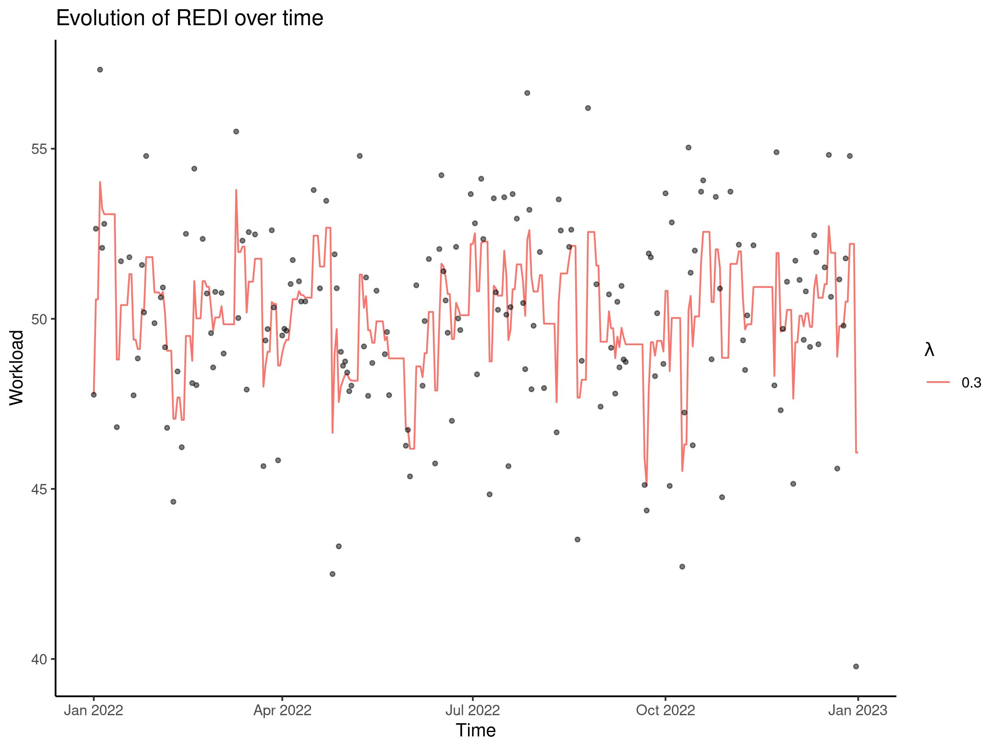{width=55%}</center>

For discrete time series, we can be interested in tracking the **cumulated workload** over time. This can be seen as a discrete integral of successive measurements.

## Naive approaches can be useful but are often limited

:::: {.columns}

::: {.column width="50%"}

$ACWR(t) = \dfrac{\bar{L}_{week}(t)}{\sum\limits_{i=0}^{3} \bar{L}_{week}(t - 7i)}$  

<br> 
$EWMA(t) = \lambda_N L(t) + (1- \lambda_N) \text{EWMA}(t-1)$

with:
$\lambda_N = \dfrac{2}{N + 1}$

:::

::: {.column width="50%"}
<center>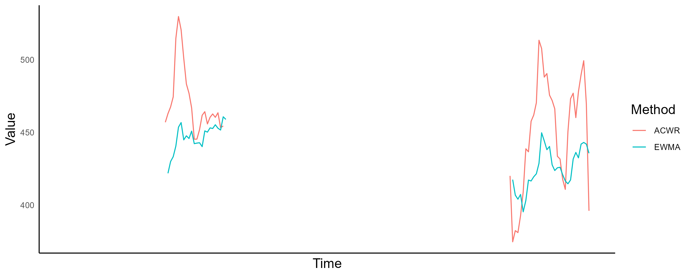{width=100%}</center>
:::

::::

<br> 

**ACWR** (*Acute Chronic Workload Ratio*) and **EWMA** (*Exponential Weighted Moving Average*) have been proposed to compute cumulated workload, but [mathematical problems]{.orange} (sensible to missing data, biased, fixed decreasing behaviour) prevent their direct use in practice. 

<br> 

[**Hulin et al.** *The acute:chronic workload ratio predicts injury: high chronic workload may decrease injury risk [...].* Br J Sports Med. 2016]{.source}

## Understanding properties of functions to develop adapted tools

**REDI** (*Robust Exponential Decreasing Index*) has been developed to overcome those issues by looking at this problem from a functional perspective. Computing (discrete) integrals from measurements allow us to track cumulated workload in a more [robust]{.orange} and [flexible]{.orange} way. 

<center>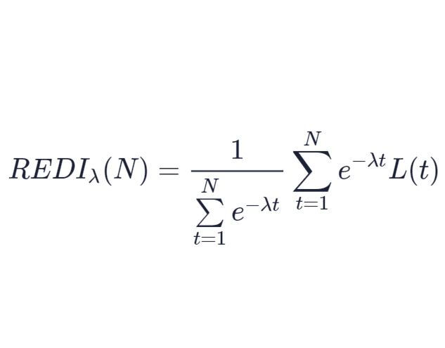{width=35%}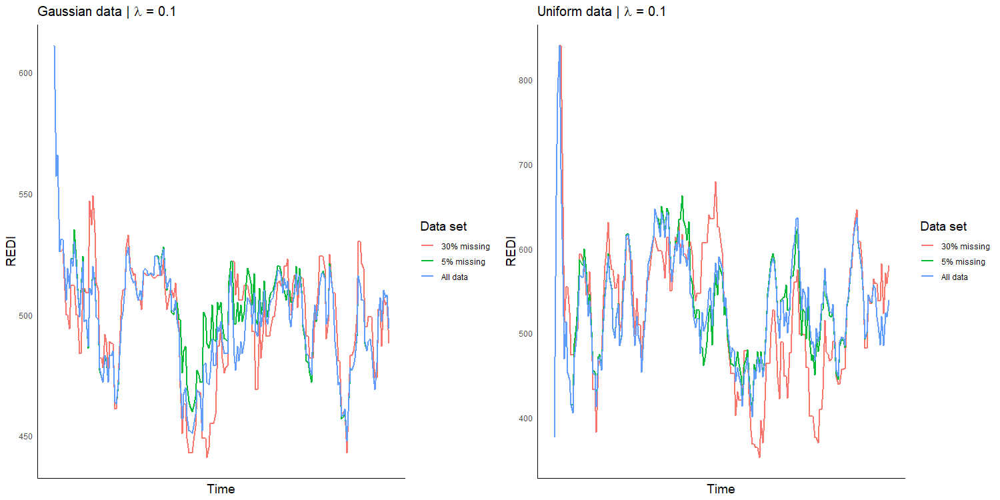{width=64%}</center>

Computed with the R package **REDI** or the web app <https://arthurleroy.shinyapps.io/REDI/>. 

## Practice time!

We can switch to the notebook for the first time and start practicing. 

<center>{width=80%}</center>


## Sport science data: specific constraints

:::: {.columns}

::: {.column width="60%"}

- [Small samples]{.orange}: Elite athletes are few: median of **10 participants per group** across 232 published studies (Lohse et al., 2020); median *n* = 19 in the *Journal of Sports Sciences*, with only 10% reporting an a priori power analysis (Abt et al., 2020)
- [Inter-individual variability]{.orange}: Athletes differ in baseline level, response to training, day-to-day fluctuations... while the effects of interest are often *small* compared to these differences (Mengersen et al., 2016)
- [Need to quantify uncertainty]{.orange}: *how sure are we that the effect exceeds the smallest worthwhile change?* rather than *is p < 0.05?*
:::

::: {.column width="40%"}
```{r}
#| echo: false
#| fig-width: 6.4
#| fig-height: 4.4
#| fig-align: center
n_grid  <- 4:60
effects <- c("Small (d = 0.2)" = 0.2, "Medium (d = 0.5)" = 0.5, "Large (d = 0.8)" = 0.8)
pw_fun <- function(d) sapply(n_grid, function(k) power.t.test(n = k, delta = d, sd = 1, sig.level = 0.05)$power)
pow <- do.call(rbind, lapply(names(effects), function(nm)
  data.frame(n = n_grid, power = pw_fun(effects[[nm]]), effect = factor(nm, levels = names(effects)))))

ggplot(pow, aes(n, power, colour = effect)) +
  annotate("rect", xmin = 8, xmax = 15, ymin = 0, ymax = 1, fill = col_grey, alpha = .15) +
  geom_hline(yintercept = 0.8, linetype = "dashed", colour = "grey30") +
  geom_line(linewidth = 1.4) +
  scale_colour_manual(values = c(col_red, col_blue, col_green)) +
  scale_y_continuous(labels = scales::percent_format(accuracy = 1), limits = c(0, 1)) +
  labs(x = "Participants per group", y = "Power (two-sample t-test, α = 0.05)", colour = NULL,
       title = "What typical sample sizes can detect",
       caption = "Shaded: interquartile range of group sizes (8 to 15) in 232 sport science studies")
```
:::

::::

[**Lohse et al.** *Systematic review of the use of "magnitude-based inference" in sports science and medicine.* PLoS ONE. 2020]{.source}  
[**Abt et al.** *Power, precision, and sample size estimation in sport and exercise science research.* J Sports Sci. 2020]{.source}  
[**Mengersen et al.** *Bayesian estimation of small effects in exercise and sports science.* PLoS ONE. 2016]{.source}

## NHST pitfalls (1/3): a noisy statistic, easily misread

:::: {.columns}

::: {.column width="50%"}
::: {style="font-size:0.75em"}
| Common belief | What the p-value really is |
|:------------------------|:----------------------------------------|
| "p < 0.05: 95% chance that the effect is real" | $p = \mathbb{P}(\text{data this extreme} \mid H_0)$, **not** $\mathbb{P}(H_0 \mid \text{data})$. |
| "p > 0.05: the training has no effect" | Absence of evidence is not evidence of absence |
| "Significant means important" | It mixes effect size and precision: a tiny effect with a large *n* gives a tiny *p* |
| "A small p will be small again next time" | It varies wildly from one replication to the next (figure) |
:::
:::

::: {.column width="50%"}
```{r}
#| echo: false
#| fig-width: 6.6
#| fig-height: 5
#| fig-align: center
set.seed(2026)
n <- 12; delta <- 0.5; K <- 20
res <- do.call(rbind, lapply(seq_len(K), function(i) {
  x  <- rnorm(n, delta); y <- rnorm(n)
  tt <- t.test(x, y, var.equal = TRUE)
  data.frame(rep = i, est = mean(x) - mean(y), lo = tt$conf.int[1], hi = tt$conf.int[2], p = tt$p.value)
}))
res$sig <- res$p < 0.05
res$rep <- factor(res$rep, levels = rev(seq_len(K)))
pw_rep <- power.t.test(n = n, delta = delta, sd = 1)$power
xlab_pos <- max(res$hi) + 0.15

ggplot(res, aes(x = est, y = rep, colour = sig)) +
  geom_vline(xintercept = 0, linetype = "dashed", colour = "grey30") +
  geom_vline(xintercept = delta, colour = col_green, linewidth = 1) +
  geom_linerange(aes(xmin = lo, xmax = hi), orientation = "y", linewidth = 1) +
  geom_point(size = 2.8) +
  geom_text(aes(x = xlab_pos, label = sprintf("p = %.3f", p)), hjust = 0, colour = "grey20", size = 4) +
  scale_colour_manual(values = c("TRUE" = col_red, "FALSE" = "grey55"),
                      labels = c("TRUE" = "p < 0.05", "FALSE" = "p ≥ 0.05")) +
  coord_cartesian(xlim = c(min(res$lo) - 0.1, xlab_pos + 0.9)) +
  labs(x = "Estimated difference (SD units) and 95% CI", y = NULL, colour = NULL,
       title = "The same experiment, replicated 20 times",
       subtitle = sprintf("True effect = %.1f SD (green line), n = %d per group, power ≈ %.0f%%", delta, n, 100 * pw_rep)) +
  theme(axis.text.y = element_blank(), panel.grid.major.y = element_blank())
```
:::

::::

[**Wasserstein & Lazar** *The ASA statement on p-values: context, process, and purpose.* Am Stat. 2016]{.source}  
[**Cumming** *Replication and p intervals: p values predict the future only vaguely [...].* Perspect Psychol Sci. 2008]{.source}

## NHST pitfalls (2/3): low power and the significance filter

:::: {.columns}

::: {.column width="58%"}
```{r}
#| echo: false
#| fig-width: 7.2
#| fig-height: 4.8
#| fig-align: center
set.seed(1)
n <- 12; delta <- 0.3; B <- 20000; df <- 2 * n - 2
est <- rnorm(B, delta, sqrt(2 / n))                     # estimated difference
se  <- sqrt(rchisq(B, df) / df) * sqrt(2 / n)           # its estimated standard error
sig <- abs(est / se) > qt(0.975, df)
sims <- data.frame(est = est, sig = sig)
power    <- mean(sig)
mean_sig <- mean(est[sig])
wrong    <- mean(est[sig] < 0)

ggplot(sims, aes(est)) +
  geom_histogram(binwidth = 0.05, boundary = 0, fill = "grey78", colour = "white") +
  geom_histogram(data = subset(sims, sig), binwidth = 0.05, boundary = 0, fill = col_red, colour = "white") +
  geom_vline(xintercept = delta, colour = col_green, linewidth = 1.3) +
  geom_vline(xintercept = mean_sig, colour = col_red, linetype = "dashed", linewidth = 1.3) +
  annotate("text", x = delta - 0.04, y = Inf, vjust = 1.6, hjust = 1, size = 5, fontface = "bold",
           colour = col_green, label = sprintf("True effect\n= %.1f SD", delta)) +
  annotate("text", x = mean_sig + 0.04, y = Inf, vjust = 1.6, hjust = 0, size = 5, fontface = "bold",
           colour = col_red, label = sprintf("Mean of significant\nresults = %.2f SD\n(%.1f× the truth)", mean_sig, mean_sig / delta)) +
  coord_cartesian(xlim = c(-1.2, 1.5)) +
  labs(x = "Estimated effect (SD units)", y = "Number of simulated studies",
       title = sprintf("%s simulated studies, n = %d per group", format(B, big.mark = ","), n),
       subtitle = sprintf("Grey: all studies. Red: significant at p < 0.05 (%.0f%% of studies; %.1f%% of them with the wrong sign)",
                          100 * power, 100 * wrong))
```
:::

::: {.column width="42%"}
- With low power, only *lucky* (over-estimated) effects cross the threshold: significant results **exaggerate** the truth (*winner's curse*)
- Add publication bias: what is published is the red tail
- Sport science: estimated average power of 53% in the *Journal of Sports Sciences* (89 p-values, signs of publication bias; Mesquida et al., 2023)

<br>
:::

::::

[**Mesquida et al.** *Publication bias, statistical power and reporting practices in the Journal of Sports Sciences.* J Sports Sci. 2023]{.source}

## NHST pitfalls (3/3): "significant" vs "not significant"

:::: {.columns}

::: {.column width="55%"}
```{r}
#| echo: false
#| fig-width: 7
#| fig-height: 3.8
#| fig-align: center
# Hypothetical example (Gelman & Stern, 2006): two trainings compared to a control, SE = 10 each
d <- data.frame(label = c("Training A vs control", "Training B vs control", "A vs B (difference)"),
                est = c(25, 10, 15), se = c(10, 10, sqrt(200)))
d$lo  <- d$est - 1.96 * d$se
d$hi  <- d$est + 1.96 * d$se
d$p   <- 2 * pnorm(-abs(d$est / d$se))
d$sig <- d$p < 0.05
d$label <- factor(d$label, levels = rev(d$label))

ggplot(d, aes(x = est, y = label, colour = sig)) +
  geom_vline(xintercept = 0, linetype = "dashed", colour = "grey30") +
  geom_linerange(aes(xmin = lo, xmax = hi), orientation = "y", linewidth = 1.3) +
  geom_point(size = 4.5) +
  geom_text(aes(x = 50, label = sprintf("p = %.2f", p)), hjust = 0, colour = "grey20", size = 5) +
  scale_colour_manual(values = c("TRUE" = col_red, "FALSE" = "grey55"), guide = "none") +
  coord_cartesian(xlim = c(-25, 66)) +
  labs(x = "Effect on performance (hypothetical units) and 95% CI", y = NULL,
       title = "A works, B does not... or do they?") +
  theme(panel.grid.major.y = element_blank(), axis.text.y = element_text(size = 14))
```
:::

::: {.column width="45%"}
- **A** is "significant", **B** is not, yet the *difference* between them is not: the data do not show that A beats B (Gelman & Stern, 2006)
- "No significant difference" is routinely read as "no effect", although the CI is often compatible with both large benefits and trivial effects
- Dichotomising turns a continuum of evidence into a verdict: p = 0.049 vs p = 0.051

<br>

:::

::::

**What we really want**:  
An estimate of the effect, **with its uncertainty**, and how likely it is to matter in practice.

[**Gelman & Stern** *The difference between "significant" and "not significant" is not itself statistically significant.* Am Stat. 2006]{.source}

## Case study: Magnitude-Based Inference (MBI) {.smaller}

:::: {.columns}

::: {.column width="48%"}
- Proposed by **Batterham & Hopkins (2006)**, promoted by **Hopkins et al. (2009)**, implemented in Excel spreadsheets on *sportsci.org*; used almost exclusively in sport and exercise science
- Born from legitimate concerns: over-reliance on significance, neglect of effect sizes, unpublished null results, small samples

:::

::: {.column width="52%"}
```{r}
#| echo: false
#| fig-width: 6.6
#| fig-height: 4.6
#| fig-align: center
est <- 0.6; se <- 0.4; delta <- 0.2
p_h <- pnorm((-delta - est) / se)
p_b <- 1 - pnorm((delta - est) / se)
p_t <- 1 - p_h - p_b
p0  <- 2 * pnorm(-abs(est / se))
x    <- seq(-1.1, 2.3, length.out = 700)
dens <- data.frame(x = x, y = dnorm(x, est, se))

ggplot(dens, aes(x, y)) +
  geom_area(data = subset(dens, x <= -delta), fill = col_red, alpha = .5) +
  geom_area(data = subset(dens, x >= -delta & x <= delta), fill = col_grey, alpha = .45) +
  geom_area(data = subset(dens, x >= delta), fill = col_green, alpha = .45) +
  geom_line(linewidth = 1.3, colour = "grey20") +
  geom_vline(xintercept = c(-delta, delta), linetype = "dashed", colour = "grey30") +
  annotate("text", x = -0.65, y = 1.12, label = sprintf("Harmful\n%.1f%%", 100 * p_h),
           colour = col_red, fontface = "bold", size = 5, lineheight = .9) +
  annotate("text", x = 0, y = 1.12, label = sprintf("Trivial\n%.0f%%", 100 * p_t),
           colour = "grey35", fontface = "bold", size = 5, lineheight = .9) +
  annotate("text", x = 1.2, y = 1.12, label = sprintf("Beneficial\n%.0f%%", 100 * p_b),
           colour = col_green, fontface = "bold", size = 5, lineheight = .9) +
  coord_cartesian(ylim = c(0, 1.25)) +
  labs(x = "True effect (SD units)", y = NULL,
       title = "MBI reads the sampling distribution as a distribution of the true effect",
       subtitle = sprintf("Observed effect = %.1f SD, SE = %.1f (normal approximation); dashed lines: ±%.1f SD", est, se, delta)) +
  theme(axis.text.y = element_blank(), plot.title = element_text(size = 13))
```
:::

::::

[**Batterham & Hopkins** *Making meaningful inferences about magnitudes.* Int J Sports Physiol Perform. 2006]{.source}  
[**Hopkins et al.** *Progressive statistics for studies in sports medicine and exercise science.* Med Sci Sports Exerc. 2009]{.source}

## MBI: from probabilities to decisions {.smaller}

:::: {.columns}

::: {.column width="42%"}
- **Trivial zone**: ±0.2 SD (default)
- **Chance of benefit / harm**: area of the distribution of the true effect above +0.2 / below −0.2
- **Unclear** if the chance of benefit *and* the chance of harm both exceed 5%, i.e. the 90% CI overlaps both zones
- **Clinical MBI**: effect is useful if chance of benefit > 25% and risk of harm < 0.5%
:::

::: {.column width="58%"}
```{r}
#| echo: false
#| fig-width: 7.4
#| fig-height: 4.1
#| fig-align: center
delta <- 0.2; eta <- 0.05
cases <- data.frame(id = LETTERS[1:6],
                    est = c(1.0, 0.6, 0.5, 0.1, 0.0, -0.7),
                    se  = c(0.25, 0.4, 0.45, 0.1, 0.3, 0.3))
cases$p_b <- 1 - pnorm((delta - cases$est) / cases$se)
cases$p_h <- pnorm((-delta - cases$est) / cases$se)
cases$p_t <- 1 - cases$p_b - cases$p_h

mbi_label <- function(pb, pt, ph) {
  if (pb > eta && ph > eta) return("Unclear")
  p <- c(beneficial = pb, trivial = pt, harmful = ph)
  k <- which.max(p)
  d <- as.character(cut(p[k], c(0, .75, .95, .995, 1.0001), right = FALSE,
                         labels = c("Possibly", "Likely", "Very likely", "Most likely")))
  paste(d, names(p)[k])
}
cases$label <- mapply(mbi_label, cases$p_b, cases$p_t, cases$p_h)
cases$clear <- cases$label != "Unclear"
cases$txt   <- sprintf("%s\nbenefit %.0f%% | harm %.1f%%", cases$label, 100 * cases$p_b, 100 * cases$p_h)
cases$id    <- factor(cases$id, levels = rev(cases$id))
cases$lo    <- cases$est - qnorm(0.95) * cases$se
cases$hi    <- cases$est + qnorm(0.95) * cases$se

ggplot(cases, aes(x = est, y = id, colour = clear)) +
  annotate("rect", xmin = -delta, xmax = delta, ymin = -Inf, ymax = Inf, fill = col_grey, alpha = .2) +
  geom_vline(xintercept = 0, colour = "grey60") +
  geom_linerange(aes(xmin = lo, xmax = hi), orientation = "y", linewidth = 1.3) +
  geom_point(size = 3.8) +
  geom_text(aes(x = 1.6, label = txt), hjust = 0, size = 4.2, lineheight = .95, fontface = "bold") +
  scale_colour_manual(values = c("TRUE" = col_blue, "FALSE" = "grey55"), guide = "none") +
  coord_cartesian(xlim = c(-1.2, 3.6)) +
  labs(x = "Observed effect (SD) and 90% CI; grey band = trivial zone", y = NULL,
       title = "Six hypothetical results and their MBI labels",
       subtitle = "Non-clinical MBI, default settings, normal approximation") +
  theme(panel.grid.major.y = element_blank(), axis.text.y = element_text(size = 14))
```
:::

::::

| < 0.5% | 0.5–5% | 5–25% | 25–75% | 75–95% | 95–99.5% | > 99.5% |
|:----:|:----:|:----:|:----:|:----:|:----:|:----:|
| most unlikely | very unlikely | unlikely | possible | likely | very likely | most likely |

## MBI is not Bayesian: the missing and implicit prior {.smaller}


```{r}
#| echo: false
#| fig-width: 6.6
#| fig-height: 4.8
#| fig-align: center
est <- 0.6; se <- 0.4; delta <- 0.2; tau0 <- 0.3     # tau0: illustrative skeptical prior
post_var <- 1 / (1 / se^2 + 1 / tau0^2)
post_mu  <- post_var * est / se^2
post_sd  <- sqrt(post_var)
pb_flat  <- 1 - pnorm((delta - est) / se)
pb_skep  <- 1 - pnorm((delta - post_mu) / post_sd)

x   <- seq(-1, 2, length.out = 600)
lev <- c("prior", "flat", "skep")
labs_ <- c(prior = sprintf("Skeptical prior N(0, sd = %.1f)", tau0),
           flat  = sprintf("Posterior, flat prior (MBI): P(benefit) = %.0f%%", 100 * pb_flat),
           skep  = sprintf("Posterior, skeptical prior: P(benefit) = %.0f%%", 100 * pb_skep))
d <- data.frame(x = rep(x, 3),
                y = c(dnorm(x, 0, tau0), dnorm(x, est, se), dnorm(x, post_mu, post_sd)),
                curve = factor(rep(lev, each = length(x)), levels = lev))

ggplot(d, aes(x, y, colour = curve, linetype = curve)) +
  geom_vline(xintercept = c(-delta, delta), colour = "grey60", linetype = "dotted") +
  geom_line(linewidth = 1.4) +
  scale_colour_manual(values = c(prior = col_grey, flat = col_red, skep = col_green), labels = labs_) +
  scale_linetype_manual(values = c(prior = "dashed", flat = "solid", skep = "solid"), labels = labs_) +
  guides(colour = guide_legend(ncol = 1), linetype = guide_legend(ncol = 1)) +
  labs(x = "True effect (SD units)", y = NULL, colour = NULL, linetype = NULL,
       title = "Same data, different prior",
       subtitle = sprintf("Observed effect = %.1f SD, SE = %.1f; dotted lines: ±%.1f SD (illustrative prior)", est, se, delta)) +
  theme(axis.text.y = element_blank(), legend.key.width = unit(1.4, "cm"), legend.text = element_text(size = 12))
```

## MBI allows you to publish more often...

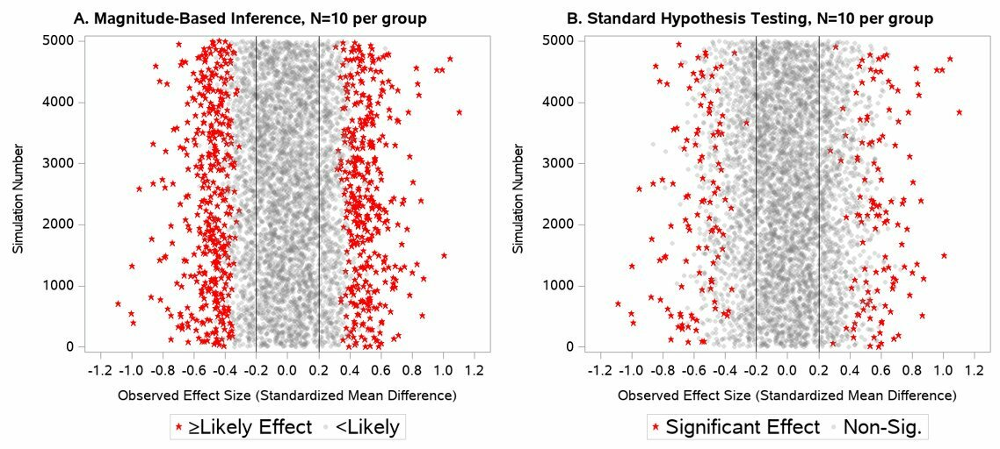{fig-align="center" width="100%"}

## ... because MBI inflates false positives

```{r}
#| echo: false
#| fig-width: 7.2
#| fig-height: 4.6
#| fig-align: center
# Own simulation following Lohse et al. (2020): two-group comparison, true effect = 0,
# non-clinical MBI with default settings (trivial zone +-0.2, risk of harm/benefit threshold 5%)
set.seed(42)
mbi_type1 <- function(n, vr, B = 4e4, delta = 0.2, eta = 0.05) {
  df  <- 2 * n - 2
  sdv <- sqrt(vr)
  est <- rnorm(B, 0, sdv * sqrt(2 / n))
  se  <- sdv * sqrt(rchisq(B, df) / df) * sqrt(2 / n)
  p_b <- pt((est - delta) / se, df)        # "chance of benefit"
  p_h <- pt((-delta - est) / se, df)       # "chance of harm"
  clear <- !(p_b > eta & p_h > eta)
  p   <- 2 * pt(-abs(est / se), df)
  data.frame(n = n, vr = vr,
             possible = mean(clear & pmax(p_b, p_h) >= 0.25),
             likely   = mean(clear & pmax(p_b, p_h) >= 0.75),
             nhst     = mean(p < 0.05))
}
grid <- expand.grid(n = 5:40, vr = c(1, 0.364))
res  <- do.call(rbind, Map(mbi_type1, grid$n, grid$vr))
res$design <- factor(res$vr, levels = c(1, 0.364),
                     labels = c("Cross-sectional (variance 1.0)", "Pre-post (variance 0.36)"))
long <- rbind(
  data.frame(n = res$n, design = res$design, rate = res$possible, rule = "MBI 'possible'"),
  data.frame(n = res$n, design = res$design, rate = res$likely,   rule = "MBI 'likely'"),
  data.frame(n = res$n, design = res$design, rate = res$nhst,     rule = "NHST p < 0.05"))

ggplot(long, aes(n, rate, colour = rule)) +
  annotate("rect", xmin = 8, xmax = 15, ymin = 0, ymax = Inf, fill = col_grey, alpha = .15) +
  geom_hline(yintercept = 0.05, linetype = "dashed", colour = "grey30") +
  geom_line(linewidth = 1.3) +
  facet_wrap(~ design) +
  scale_colour_manual(values = c("MBI 'possible'" = col_purple, "MBI 'likely'" = col_red, "NHST p < 0.05" = col_blue)) +
  scale_y_continuous(labels = scales::percent_format(accuracy = 1), limits = c(0, NA)) +
  labs(x = "Participants per group", y = "False-positive rate (true effect = 0)", colour = NULL,
       title = "How often does MBI call an ineffective intervention effective?",
       caption = "Shaded: interquartile range of group sizes in 232 MBI studies") +
  theme(strip.text = element_text(face = "bold", size = 13), plot.title = element_text(size = 13))
```

## From MBI to a proper Bayesian analysis {.smaller}

MBI asked the right question, *how likely is the effect to be worthwhile?*, but answered it with a flawed methodology. 

| Constraint in sport science | Where NHST and MBI struggle | What a Bayesian analysis brings |
|:-----------------|:-------------------------|:-------------------------------|
| **Small samples** | Low power, exaggerated significant effects; implicit flat prior in MBI | **Explicit, weakly informative priors** regularise extreme estimates; no asymptotic approximation needed; sensitivity analysis to the prior |
| **Inter-individual variability** | Pooled analyses hide it; athlete-by-athlete analyses are underpowered | **Hierarchical models**: partial pooling, shrinkage, athlete-level posteriors (next chapters) |
| **Quantifying uncertainty** | Binary significance verdict; MBI's pseudo-probabilities | **Posterior distribution**: $\mathbb{P}(\text{effect} > \text{smallest worthwhile change} \mid \text{data})$ and credible intervals, valid given the prior |

<br>

**What we keep from MBI**:  
Estimation over dichotomy, probabilistic statements about the *magnitude* of effects, and a smallest worthwhile change defined by the practitioner. A Bayesian formulation of these goals exists, and it makes the assumptions explicit.

## What is Uncertainty?

:::: {.columns}

::: {.column width="50%"}
::: {.callout-note title="Aleatoric (Data) Uncertainty" icon=false}
- Inherent randomness in the process.
- Cannot be reduced by more data.
- *Example:* Sensor noise, dice roll.
:::
:::

::: {.column width="50%"}
::: {.callout-note title="Epistemic (Model) Uncertainty" icon=false}
- Due to lack of knowledge or limited data.
- Can be reduced with more observations.
- *Example:* Unknown model parameters.
:::
:::

::::

```{r}
#| fig-width: 8
#| fig-height: 3.2
#| fig-align: center
xt   <- c(0.5, 1, 2, 3, 4, 5, 5.8)
grid <- seq(min(xt), max(xt), length.out = 200)
smooth <- function(y) splinefun(xt, y, method = "natural")(grid)

curves <- data.frame(
  x     = grid,
  truth = smooth(c(1, 1.2, 2.8, 3, 2.2, 2.8, 3)),      # true function
  lo    = smooth(c(0.8, 1.5, 2.5, 3.3, 2.4, 2.7, 2.9)), # model band (epistemic)
  hi    = smooth(c(1.3, 2.2, 3.1, 3.7, 2.8, 3.0, 3.2))
)
pts <- data.frame(                                        # noisy data (aleatoric)
  x = c(0.8, 1.5, 2.5, 3.5, 4.5, 5.3),
  y = c(1.1, 2.4, 2.7, 2.3, 2.5, 3.1)
)

ggplot(curves, aes(x)) +
  geom_ribbon(aes(ymin = lo, ymax = hi), fill = col_grey, alpha = .2) +
  geom_line(aes(y = lo), linetype = "dashed", colour = col_grey, linewidth = .8) +
  geom_line(aes(y = hi), linetype = "dashed", colour = col_grey, linewidth = .8) +
  geom_line(aes(y = truth), colour = col_blue, linewidth = 1.4) +
  geom_point(data = pts, aes(x, y), colour = col_red, size = 3.5, alpha = .85) +
  annotate("text", x = 5.4, y = 3.55, label = "True function",
           colour = col_blue, fontface = "bold", size = 5) +
  annotate("text", x = 1.5, y = 0.45, label = "Aleatoric: noisy data",
           colour = col_red, fontface = "bold", size = 5) +
  annotate("text", x = 3.2, y = 4.0, label = "Epistemic: uncertain model",
           colour = col_grey, fontface = "bold", size = 5) +
  coord_cartesian(xlim = c(0, 6.5), ylim = c(0, 4.3)) +
  labs(x = "x", y = "y")
```

**Bayesian Statistics** quantifies both via probabilities — anything unobserved is random.

## Bayes formula in a nutshell

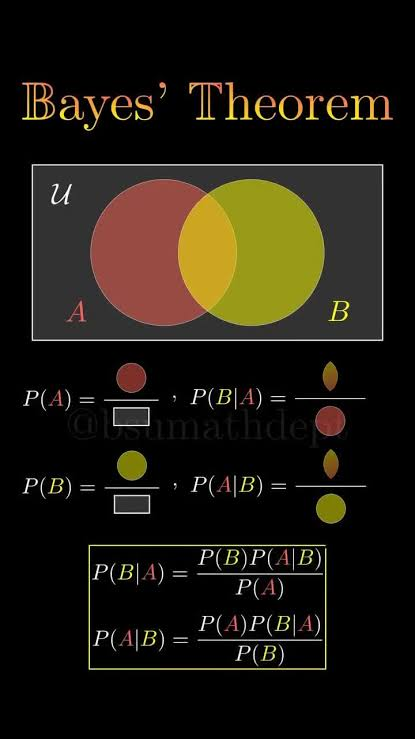{.r-stretch fig-align="center"}

## Think as proper Bayesian

- $\mathbb{P}(D) = 0.001,$ 1 person out of 1000 contracted the disease on average,
- $\mathbb{P}(T \mid D) = 0.99,$ a detection test is 99% reliable if you have the disease,
- $\mathbb{P}(\bar{T} \mid \bar{D}) = 0.99,$ this same detection test is 99% reliable if you **don't** have the disease,

. . .

$$
\begin{aligned}
\mathbb{P}(T)
  &= \mathbb{P}(T \cap D) + \mathbb{P}(T \cap \bar{D} ) \\
  &= \mathbb{P}(T | D)  \times \mathbb{P}(D) + \mathbb{P}(T | \bar{D})  \times \mathbb{P}(\bar{D}) \\
  &= \mathbb{P}(T | D)  \times \mathbb{P}(D) + (1 - \mathbb{P}(\bar{T} | \bar{D}))  \times (1 - \mathbb{P}(D)) \\
  &= 0.99 \times 0.001 + (1 - 0.99) \times (1 - 0.001) \\
  &= 0.00099 + 0.00999 \\
  &= 0.01098
\end{aligned}
$$

. . .

$$
\mathbb{P}(D | T) = \frac{\mathbb{P}(T | D) \times \mathbb{P}(D)}{\mathbb{P}(T)} = \frac{0.99 \times 0.001}{0.01098} \approx 0.09016
$$

Hence, we only have $9.016$% chance to actually be sick despite a positive result to the detection test.

## Bayesian inference: sequential updates

Bayesian inference allows us to incorporate new data as they become available.

::: {.callout-note title="Sequential Bayesian updating" icon=false}
Starting from an initial prior $p(\theta)$, we can update our beliefs each time new data is observed:

$$
\underbrace{p(\theta \mid x_1)}_{\text{Posterior after } x_1}
\propto
\underbrace{p(x_1 \mid \theta)}_{\text{Likelihood}}
\underbrace{p(\theta)}_{\text{Initial prior}}
$$

When a new observation $x_2$ arrives, the previous posterior becomes our new prior:

$$
\underbrace{p(\theta \mid x_1,x_2)}_{\text{Updated posterior}}
\propto
\underbrace{p(x_2 \mid \theta)}_{\text{New likelihood}}
\underbrace{p(\theta \mid x_1)}_{\text{Previous posterior}}
$$
:::

More generally, assuming observations are conditionally independent given $\theta$:

$$
\boxed{
  p(\theta \mid x_{1:n})
  \propto p(x_n \mid \theta)\,p(\theta \mid x_{1:n-1})
}
$$

*Each new observation brings additional information, progressively refining our beliefs about $\theta$.*

## Think as proper Bayesian: sequential updates

After the first test, we updated our beliefs about chances of being sick, thus:

- $\mathbb{P}(D \mid T) = 0.09016$ (current probability of the disease),

Imagine we take the same kind of test again, independently, and get a positive result.

. . .

$$
\begin{aligned}
\mathbb{P}(T_2)
  &= \mathbb{P}(T_2\mid D)\,\mathbb{P}(D\mid T) + \mathbb{P}(T_2\mid\bar{D})\,\mathbb{P}(\bar{D} \mid T) \\
  &= 0.99 \times 0.09016 + 0.01 \times (1-0.09016) \\
  &\approx 0.08926 + 0.00909 \\
  &\approx 0.09836
\end{aligned}
$$

. . .

$$
\mathbb{P}(D \mid T, T_2)
= \frac{\mathbb{P}(T_2\mid D)\,\mathbb{P}(D \mid T)}{\mathbb{P}(T_2)}
= \frac{0.99 \times 0.09016}{0.09836}
\approx \boxed{0.9075}
$$

- After one positive test: $\approx 9.0\%$ chance of disease.
- After a *second independent* positive test: $\approx 90.8\%$ chance.

## Choosing a prior

::: {.callout-note title="Expert knowledge" icon=false}
The prior $p(\theta)$ may be used to represent any available expert knowledge on $\theta$.
:::

::: {.callout-note title="Conjugate priors" icon=false}
When the prior $p(\theta)$ and the posterior $p(\theta \mid x)$ belong to the same family of distributions (e.g. Gaussian, Beta, etc.), then we say that the prior is *conjugate* to the observational model $p(x \mid \theta)$.

Conjugate priors are widely used as they greatly simplify computations.
:::

::: {.callout-note title="Uninformative prior" icon=false}
When the prior equally charges $\Theta$ we say that the prior is *uninformative*, noted $p(\theta) \propto 1$.
:::

## Example of conjugacy: the Beta-Binomial model (1) {#betabinomialexample}

::: {.callout-note title="Observational model: the likelihood" icon=false}

$$
p(\mathbf{X} \mid \theta) = \prod_{i=1}^{n} \text{Ber}(x_i \mid \theta)  = \theta^{\sum_{i} x_i} (1-\theta)^{\sum_i 1 - x_i}.
$$
:::

::: {.callout-note title="Choice of a prior" icon=false}

$$
p(\theta) = \text{Beta}(a, b) \propto \mathbf{1}_{[0,1]}(\theta) \theta^{a-1} (1-\theta)^{b-1}.
$$
- $a=b=1$ : uniform on $[0,1]$ (uninformative)
- $a=b > 1$ : in favor of a balanced coin, the greater $a$, the stronger the prior
- $a > b$ (resp. $a<b$): in favor of tail (resp. head).
:::

## Example of conjugacy: the Beta-Binomial model (2)

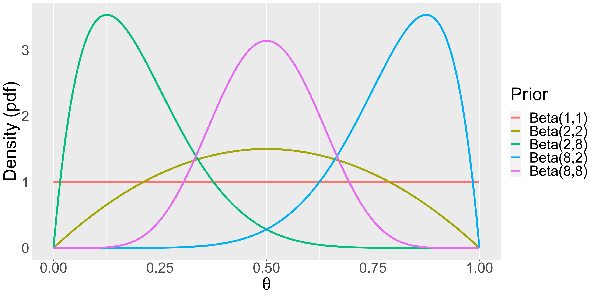{fig-align="center" width="100%"}

## Example of conjugacy: the Beta-Binomial model (3)

We seek to derive the posterior, and we directly have

$$
\begin{aligned}
p(\theta \mid \mathbf{X}) & \propto p(\mathbf{X} \mid \theta) p(\theta), \\
 & \propto \theta^{\sum_{i} x_i} (1-\theta)^{\sum_i 1 - x_i} \theta^{a-1} (1-\theta)^{b-1} \mathbf{1}_{[0,1]}(\theta), \\
 & \propto \theta^{a + \sum_{i} x_i - 1} (1-\theta)^{b + n - \sum_i  x_i - 1} \mathbf{1}_{[0,1]}(\theta).
\end{aligned}
$$

We recognize the p.d.f of a Beta distribution

$$
\theta \mid \mathbf{X} \sim \text{Beta}\left(a + \sum_i X_i, b + n - \sum_{i} X_i \right)
$$


- $a$ and $b$ act as *pseudo-counts* for head and tails, smoothing the estimates when $n$ is small.
- This conjugacy between the Beta prior and the binomial model always hold : property of the model (prior + likelihood) and not our specific experiment.


## Limits of the conjugate framework {.smaller}


| **Likelihood**                      | **Prior**       | **Posterior**   |
|:------------------------------------|:---------------:|:---------------:|
| Binomial                            | Beta            | Beta            |
| Negative Binomial                   | Beta            | Beta            |
| Poisson                             | Gamma           | Gamma           |
| Geometric                           | Beta            | Beta            |
| Exponential                         | Gamma           | Gamma           |
| Normal (mean unknown)               | Normal          | Normal          |
| Normal (variance unknown)           | Inverse Gamma   | Inverse Gamma   |
| Normal (mean and variance unknown)  | Normal / Gamma  | Normal / Gamma  |
| Multinomial                         | Dirichlet       | Dirichlet       |

- Conjugacy exists only for specific likelihood-prior pairs.
- Many models of practical interest (logistic, complex hierarchies, ...) are non-conjugate.

We therefore use **approximate** or **sampling-based** methods to compute general posteriors.


## Beta-Binomial conjugacy: a visual illustration

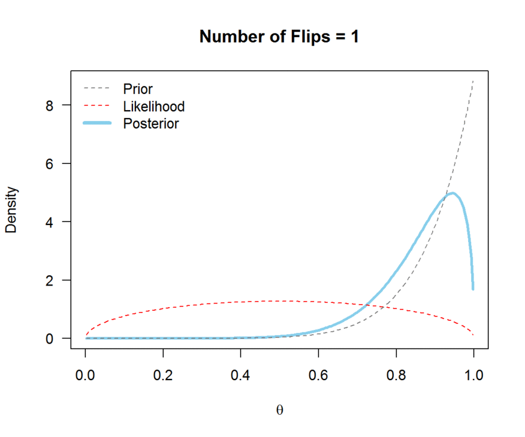{fig-align="center" width="100%"}

## Difference between Confidence and Credible Intervals

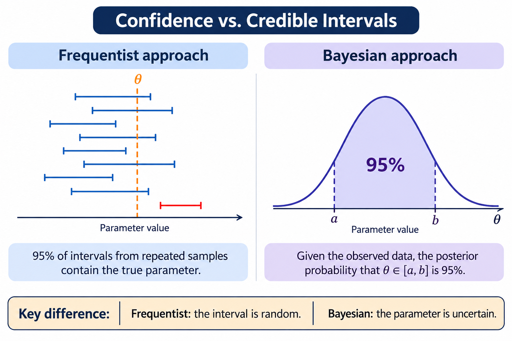{fig-align="center" width="90%"}

## Uncertainty instead of binary decisions, posteriors instead of tests {#posteriors-gif}

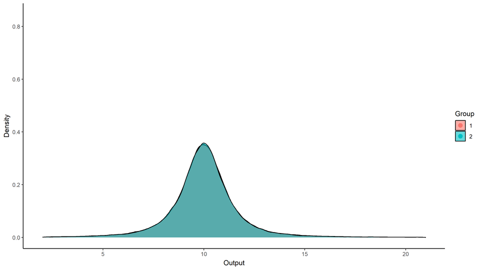{fig-align="center" width="100%"}

## Interpretation of posterior differences

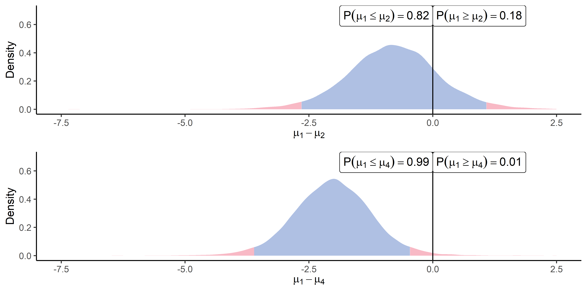{fig-align="center" width="100%"}


## Discretising continuous variables: what do we throw away? {.smaller}

:::: {.columns}

::: {.column width="50%"}
```{r}
#| echo: false
#| fig-width: 6.2
#| fig-height: 4.5
#| fig-align: center
set.seed(11)
n <- 60; r <- 0.35
x <- sort(rnorm(n)); y <- r * x + sqrt(1 - r^2) * rnorm(n)
med  <- median(x)
low  <- x <= med
m_lo <- mean(y[low]); m_hi <- mean(y[!low])
idx  <- c(A = n / 2, B = n / 2 + 1, C = n)     # x is sorted: A and B straddle the median, C is the maximum
hl   <- data.frame(x = x[idx], y = y[idx], lab = names(idx))
d    <- data.frame(x, y)
step <- data.frame(x = c(min(x), med, med, max(x)), y = c(m_lo, m_lo, m_hi, m_hi), g = rep(c("lo", "hi"), each = 2))

ggplot(d, aes(x, y)) +
  geom_vline(xintercept = med, linetype = "dashed", colour = "grey40") +
  geom_point(colour = "grey62", size = 2.3) +
  geom_smooth(method = "lm", formula = y ~ x, se = FALSE, colour = col_green, linewidth = 1.6) +
  geom_line(data = step, aes(group = g), colour = col_red, linewidth = 1.6) +
  geom_point(data = hl, colour = col_blue, size = 4.5) +
  geom_text(data = hl, aes(label = lab), colour = col_blue, fontface = "bold", size = 6, vjust = -1.2) +
  annotate("text", x = min(x), y = max(y), hjust = 0, vjust = 1, colour = col_green, fontface = "bold", size = 5,
           label = "Linear model: uses every athlete") +
  annotate("text", x = min(x), y = max(y), hjust = 0, vjust = 2.7, colour = col_red, fontface = "bold", size = 5,
           label = "Median split: 2 numbers") +
  labs(x = "Training load (standardised)", y = "Performance change (standardised)",
       title = "Same data, two models",
       subtitle = "A and B: almost the same load, 'different groups'.\nB and C: very different loads, 'same group'.") +
  theme(plot.subtitle = element_text(size = 12))
```
:::

::: {.column width="50%"}
```{r}
#| echo: false
#| fig-width: 6.2
#| fig-height: 4.5
#| fig-align: center
r  <- 0.3
rd <- r * sqrt(2 / pi)                       # correlation after a median split of a normal predictor
pw_r <- function(r, n) { z <- atanh(r) * sqrt(n - 3); cc <- qnorm(0.975); pnorm(z - cc) + pnorm(-z - cc) }
ng <- 10:170
lab_c <- "Continuous (correlation / regression)"
lab_d <- "Median split (t-test)"
pw <- rbind(data.frame(n = ng, power = pw_r(r,  ng), model = lab_c),
            data.frame(n = ng, power = pw_r(rd, ng), model = lab_d))
n80 <- data.frame(model = c(lab_c, lab_d),
                  n = c(min(ng[pw_r(r, ng) >= .8]), min(ng[pw_r(rd, ng) >= .8])))
n80$model <- factor(n80$model, levels = c(lab_c, lab_d))
pw$model  <- factor(pw$model,  levels = c(lab_c, lab_d))

ggplot(pw, aes(n, power, colour = model)) +
  geom_hline(yintercept = 0.8, linetype = "dashed", colour = "grey30") +
  geom_line(linewidth = 1.6) +
  geom_segment(data = n80, aes(x = n, xend = n, y = 0, yend = 0.8), linetype = "dotted", linewidth = 1) +
  geom_text(data = n80, aes(x = n, y = 0.04, label = paste0("n = ", n)), hjust = -0.15, fontface = "bold", size = 5, show.legend = FALSE) +
  scale_colour_manual(values = c(col_green, col_red)) +
  scale_y_continuous(labels = scales::percent_format(accuracy = 1), limits = c(0, 1)) +
  guides(colour = guide_legend(nrow = 2)) +
  labs(x = "Number of athletes", y = "Power (α = 0.05)", colour = NULL,
       title = sprintf("True correlation r = %.1f: sample needed for 80%% power", r),
       subtitle = sprintf("Splitting at the median needs about %.1f times more athletes", n80$n[2] / n80$n[1])) +
  theme(plot.title = element_text(size = 13), plot.subtitle = element_text(size = 12))
```
:::

::::

## Structure in the data: within vs between athletes {.smaller}

```{r}
#| echo: false
#| fig-width: 7.4
#| fig-height: 5
#| fig-align: center
set.seed(21)
J <- 8; m <- 15
mi <- seq(1, 8, length.out = J)                       # average load of each athlete
dsim <- do.call(rbind, lapply(1:J, function(i) {
  w <- rnorm(m, 0, 0.5)                               # week-to-week deviation from the athlete's usual load
  data.frame(athlete = factor(i), x = mi[i] + w, y = 1.0 * mi[i] - 1.5 * w + rnorm(m, 0, 0.5))
}))
b_pool   <- unname(coef(lm(y ~ x, dsim))[2])
b_within <- mean(sapply(split(dsim, dsim$athlete), function(s) unname(coef(lm(y ~ x, s))[2])))

ggplot(dsim, aes(x, y, colour = athlete)) +
  geom_point(size = 2.2, alpha = .85) +
  geom_smooth(aes(group = athlete), method = "lm", formula = y ~ x, se = FALSE, linewidth = 1.2) +
  geom_smooth(aes(group = 1), method = "lm", formula = y ~ x, se = FALSE, colour = "black", linetype = "dashed", linewidth = 1.5) +
  scale_colour_viridis_d(option = "D", end = .9, guide = "none") +
  annotate("text", x = 1, y = max(dsim$y), hjust = 0, vjust = 1, fontface = "bold", size = 5, lineheight = 1,
           label = sprintf("Pooled analysis (dashed): slope = %+.1f\nWithin each athlete (coloured): slope ≈ %+.1f", b_pool, b_within)) +
  labs(x = "Weekly training load (arbitrary units)", y = "Performance (arbitrary units)",
       title = "8 athletes, 15 weeks each (simulated)") +
  theme(axis.text = element_blank())
```


## Structure in the data: low individual sample sizes

<br> 

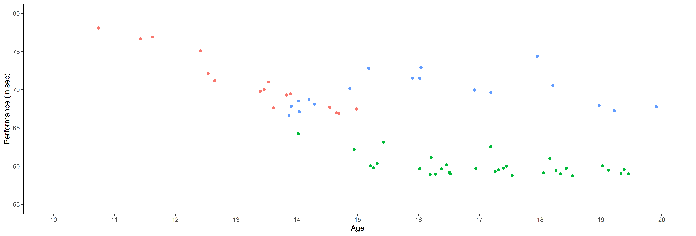{fig-align="center" width="100%"}

## Structure in the data: low individual sample sizes

<br> 

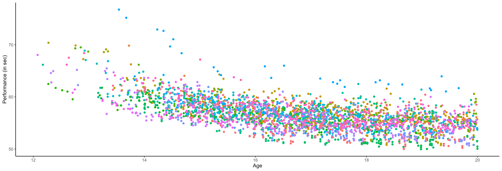{fig-align="center" width="100%"}

## Motivation: why hierarchical models?

- Data are often grouped (athlete, club, country, sensors)
- Need to share statistical strength across groups (partial pooling)
- Hierarchical models capture multi-level variation and can propagate uncertainty

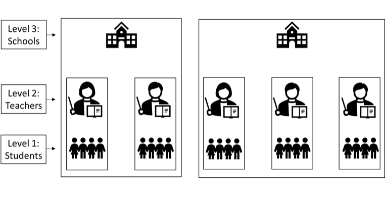{.r-stretch fig-align="center"}

## Illustrative example: linear regression

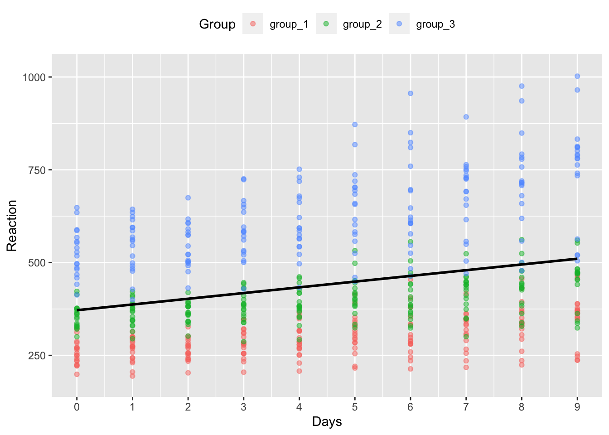{fig-align="center" width="100%"}

## Illustrative example: modeling independent groups

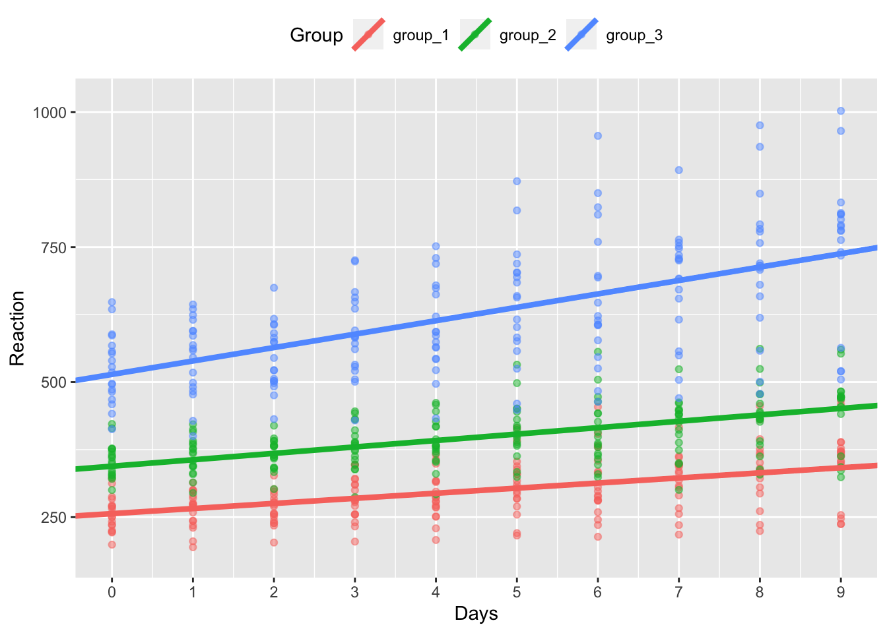{fig-align="center" width="100%"}

## Illustrative example: pooling the slope

If all groups share the same slope, we assume that the underlying mechanism is identical.

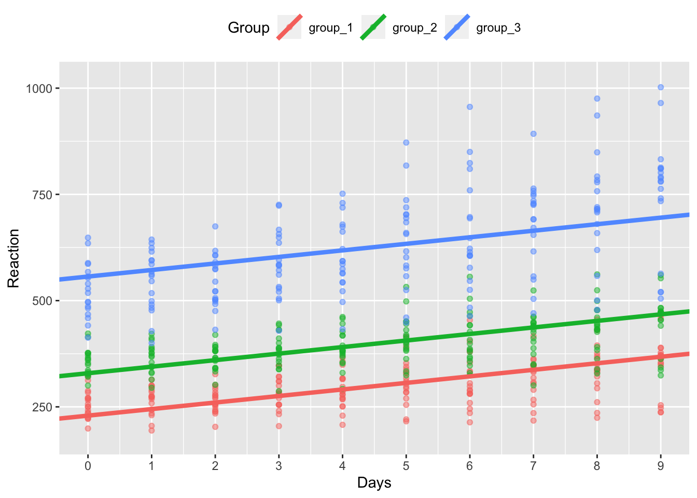{fig-align="center" width="100%"}

## Illustrative example: pooling the intercept

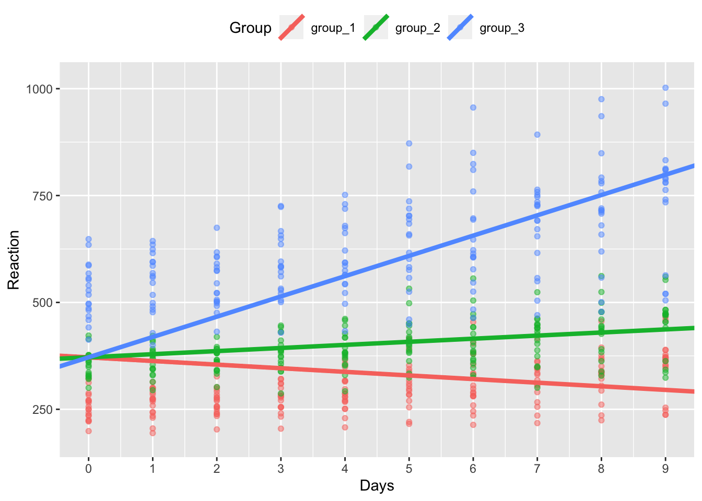{fig-align="center" width="100%"}

## Illustrative example: layers of hierarchy

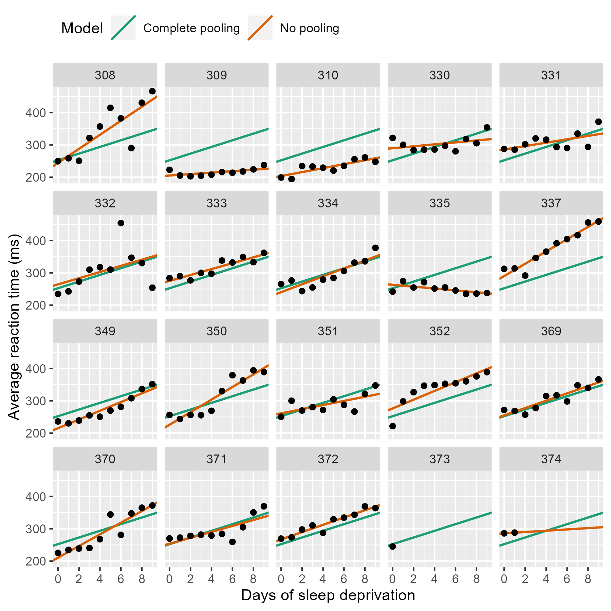{.r-stretch fig-align="center"}

## Illustrative example: shrinkage effect

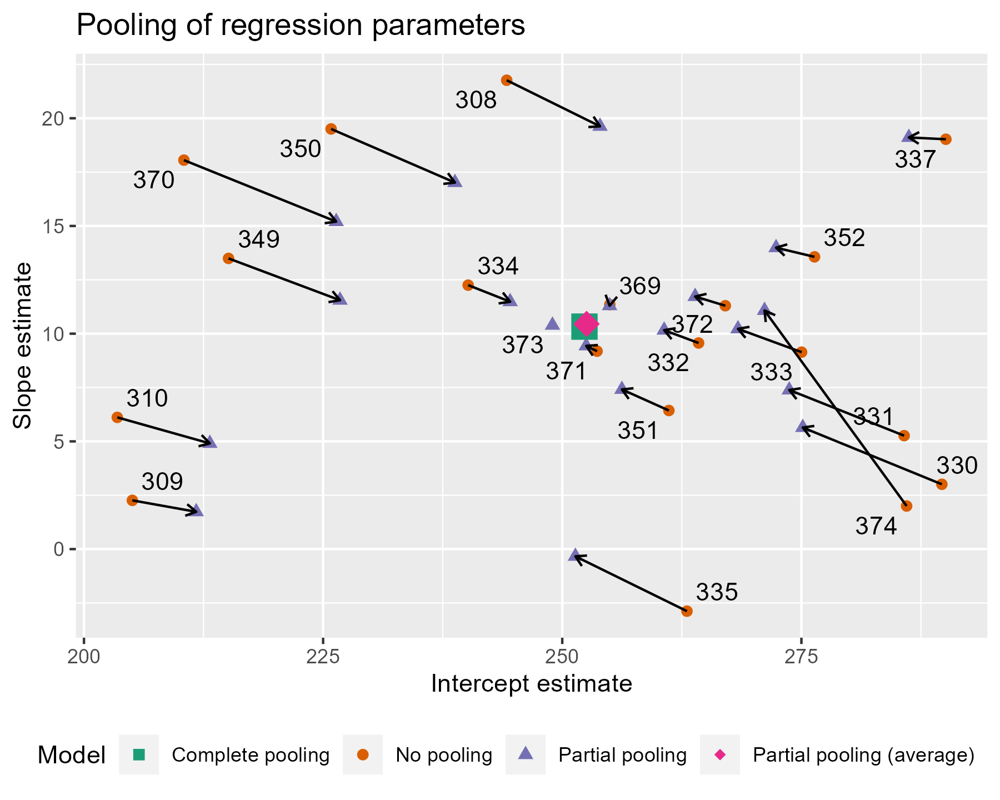{fig-align="center" width="100%"}

## Exercise: recovering dependencies and expressing probabilities

<!-- Les 3 slides suivants partagent le même graphe : sur le premier, les arêtes sont
     invisibles (style=invis), ce qui garde exactement la même mise en page. -->

```{dot}
//| fig-height: 4.8
digraph G {
  graph [rankdir=TB, nodesep=0.9, ranksep=1.0, bgcolor="transparent"]
  node  [shape=box, style="rounded", fontname="Helvetica", fontsize=18, margin="0.3,0.18", penwidth=1.4]
  edge  [arrowhead=vee, penwidth=1.4, style=invis]

  Road     [label="Road Condition"]
  Driver   [label="Driver's fatigue"]
  Braking  [label="Braking"]
  Control  [label="Control"]
  Reaction [label="Reaction\nTime"]
  Injury   [label="Injury\n(observed)", style="rounded,dashed"]

  {rank=same; Road; Driver}
  {rank=same; Braking; Control; Reaction}

  Road -> Braking
  Road -> Control
  Driver -> Control
  Driver -> Reaction
  Braking -> Injury
  Control -> Injury
  Reaction -> Injury
}
```

## Exercise: recovering dependencies and expressing probabilities

```{dot}
//| fig-height: 4.0
digraph G {
  graph [rankdir=TB, nodesep=0.9, ranksep=0.8, bgcolor="transparent"]
  node  [shape=box, style="rounded", fontname="Helvetica", fontsize=18, margin="0.3,0.18", penwidth=1.4]
  edge  [arrowhead=vee, penwidth=1.4]

  Road     [label="Road Condition"]
  Driver   [label="Driver's fatigue"]
  Braking  [label="Braking"]
  Control  [label="Control"]
  Reaction [label="Reaction\nTime"]
  Injury   [label="Injury\n(observed)", style="rounded,dashed"]

  {rank=same; Road; Driver}
  {rank=same; Braking; Control; Reaction}

  Road -> Braking
  Road -> Control
  Driver -> Control
  Driver -> Reaction
  Braking -> Injury
  Control -> Injury
  Reaction -> Injury
}
```

$$
p(I, B, C, Re, Ro, D) = p(Ro) p(D) p(B \mid Ro) p(C \mid Ro, D) p(Re \mid D) p(I \mid B, C, Re)
$$

## Bayesian Hierarchical Model: Gaussian Example

:::: {.columns}

::: {.column width="30%"}
```{dot}
//| fig-height: 5.2
digraph hier {
  graph [bgcolor="transparent", nodesep=0.7, ranksep=0.8, fontname="Helvetica"]
  node  [shape=circle, style=filled, fontname="Helvetica", fontsize=22, fixedsize=true, width=0.75, penwidth=1.6]
  edge  [arrowhead=vee, penwidth=1.4]

  // variables latentes (bleu) et observation (vert)
  mu0    [label=<μ<SUB>0</SUB>>, fillcolor="#DBEAFE", color="#3B82F6"]
  sigma0 [label=<σ<SUB>0</SUB>>, fillcolor="#DBEAFE", color="#3B82F6"]
  sigma  [label="σ",             fillcolor="#DBEAFE", color="#3B82F6"]
  mu_j   [label=<μ<SUB>j</SUB>>, fillcolor="#DBEAFE", color="#3B82F6"]
  y      [label=<y<SUB>ij</SUB>>, fillcolor="#DCFCE7", color="#22C55E"]

  mu0    -> mu_j
  sigma0 -> mu_j
  mu_j   -> y
  sigma  -> y

  // plates
  subgraph cluster_J {
    label=<j = 1,…,J>; labeljust=r; labelloc=b
    style="dashed,rounded"; color="grey40"; fontsize=16; fontname="Helvetica"
    mu_j
    subgraph cluster_N {
      label=<i = 1,…,N<SUB>j</SUB>>; labeljust=r; labelloc=b
      style="dashed,rounded"; color="grey40"; fontsize=16; fontname="Helvetica"
      y
    }
  }
}
```
:::

::: {.column width="70%"}
::: {style="font-size:0.8em"}
**Model equations:**

$$
\begin{aligned}
y_{ij} &\sim \mathcal{N}(\mu_j, \sigma^2) \\
\mu_j &\sim \mathcal{N}(\mu_0, \sigma_0^2) \\
\mu_0 &\text{: hyperparameter} \\
\sigma_0 &\text{: hyperparameter} \\
\sigma &\text{: likelihood variance}
\end{aligned}
$$

**Key points:**

- Observations $y_{ij}$ are grouped by $j$.
- Group means $\mu_j$ share information via the population-level mean $\mu_0$.
- Shrinkage: estimates for small groups are pulled toward $\mu_0$.
:::
:::

::::


## Pearson's $r$ only see straight lines and $R^2$ sees nothing 

:::: {.columns}

::: {.column width="55%"}
```{r}
#| echo: false
#| fig-width: 6.6
#| fig-height: 4.9
#| fig-align: center
a  <- datasets::anscombe
aq <- do.call(rbind, lapply(1:4, function(i)
  data.frame(set = paste("Dataset", as.character(as.roman(i))), x = a[[paste0("x", i)]], y = a[[paste0("y", i)]])))
st <- do.call(rbind, lapply(split(aq, aq$set), function(s) data.frame(set = s$set[1], r = cor(s$x, s$y))))
st$txt <- sprintf("r = %.2f, R² = %.2f", st$r, st$r^2)

ggplot(aq, aes(x, y)) +
  geom_smooth(method = "lm", formula = y ~ x, se = FALSE, colour = col_red, linewidth = 1.3) +
  geom_point(colour = col_blue, size = 3) +
  geom_text(data = st, aes(label = txt), x = -Inf, y = Inf, hjust = -0.08, vjust = 1.6,
            inherit.aes = FALSE, fontface = "bold", size = 4.4) +
  facet_wrap(~ set, nrow = 2) +
  coord_cartesian(ylim = c(3, 14.5)) +
  labs(x = NULL, y = NULL, title = "Anscombe's quartet: same r, same R², same line") +
  theme(strip.text = element_text(face = "bold", size = 13), plot.title = element_text(size = 14))
```
:::

::: {.column width="45%"}
```{r}
#| echo: false
#| fig-width: 5.6
#| fig-height: 4.9
#| fig-align: center
set.seed(4)
n  <- 100
mk <- function(sdx, lab) { x <- rnorm(n, 0, sdx); data.frame(x = x, y = x + rnorm(n), grp = lab) }
A  <- rbind(mk(1, "narrow range of x"), mk(3, "wide range of x"))
A$grp <- factor(A$grp, levels = c("narrow range of x", "wide range of x"))

r2  <- sapply(split(A, A$grp), function(d) summary(lm(y ~ x, d))$r.squared)
lbA <- data.frame(grp = factor(names(r2), levels = levels(A$grp)),
                  txt = sprintf("%s: R² = %.2f", names(r2), r2), vj = c(1.5, 3.1))

ggplot(A, aes(x, y)) +
  geom_point(aes(colour = grp), alpha = .7, size = 2) +
  geom_smooth(aes(group = 1), method = "lm", formula = y ~ x, se = FALSE, colour = "grey20", linewidth = 1.2) +
  geom_text(data = lbA, aes(label = txt, colour = grp, vjust = vj), x = -Inf, y = Inf,
            hjust = -0.05, fontface = "bold", size = 4.6, show.legend = FALSE) +
  scale_colour_manual(values = c(col_red, col_blue), guide = "none") +
  labs(x = "Predictor x", y = "Outcome y",
       title = "Same line, same noise, different R²",
       subtitle = "Only the range of x changes") +
  theme(plot.title = element_text(size = 14), plot.subtitle = element_text(size = 12))
```
:::

::::

## Non-linear relationships require non-linear methods

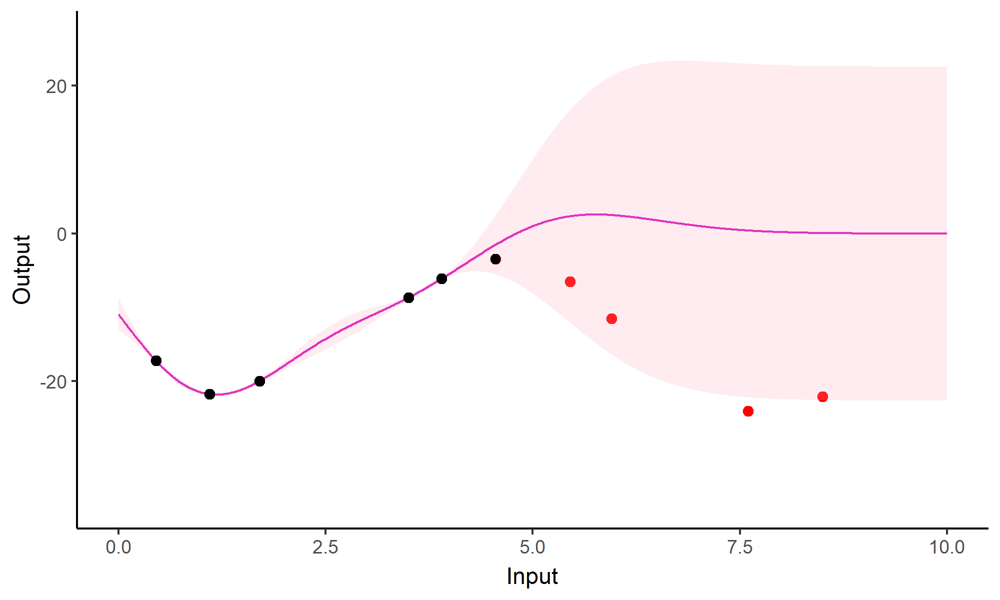{fig-align="center" width="100%"}

If you are interested in this specific topic, take a look at our previous [Atelier de Statistique 2025 : analyser des données fonctionnelles dans le sport]{.orange}
